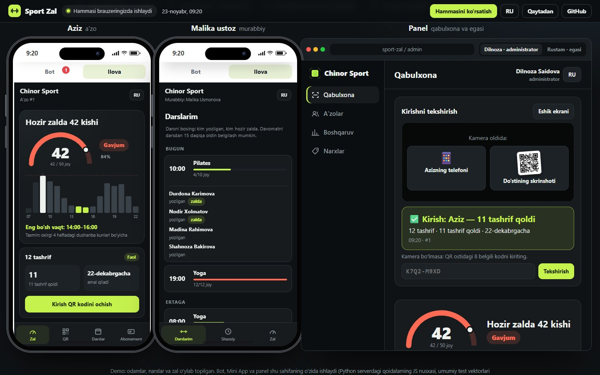
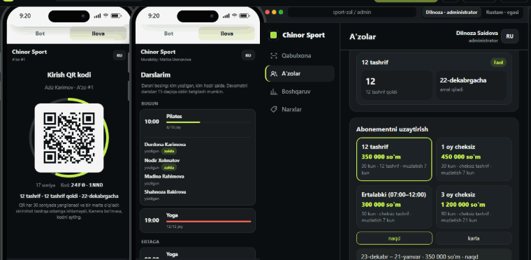
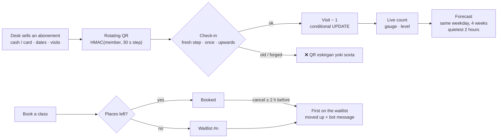

# Sport Zal

**English** · [O'zbekcha](README.uz.md)

[](https://github.com/xoliddev/sport-zal/actions/workflows/ci.yml)
[](https://xoliddev.github.io/sport-zal/)
[](LICENSE)


A **gym for Uzbekistan**: a Telegram Mini App for members, a web admin panel for the front desk and the owner, and a
bot for everything that should arrive as a message. Four roles: **a'zo** (member), **murabbiy** (trainer),
**administrator** (front desk) and **egasi** (owner).

**The wow moment — how busy the gym is right now, live.** The member's home screen says *"Hozir zalda 41 kishi"* with
a gauge (Bo'sh / O'rtacha / Gavjum against capacity) and an **hourly forecast for today**, built from the same weekday
of the past four weeks (whole-number averages of how many people were inside at every half hour), highlighting
*"Eng bo'sh vaqt: 14:00–16:00"*. The desk sees the very same number — one server function computes it for the app,
the panel, the door screen and the bot — and it moves the moment someone is let in.

**Check-in with a rotating QR.** The Mini App shows a QR that changes every 30 seconds (HMAC over the member and the
time step with a server secret), so a screenshot sent to a friend dies within a minute, and each code is accepted
once. The desk scans it with the browser's `BarcodeDetector` (or types the 8-letter code under it): *"✅ Kirish: Aziz —
11 tashrif qoldi"*, *"⚠️ Abonement tugagan"*, *"⚠️ Ertalabki abonement: hozir 18:40"*, *"❌ QR eskirgan yoki soxta"*.

**[Live demo →](https://xoliddev.github.io/sport-zal/)** Aziz's phone, Malika ustoz's phone and the admin panel in a
browser window, side by side, with a ten-step story. Everything runs in your browser.



<p align="center"></p>

## Features

- **Abonements.** "12 tashrif", "1 oy cheksiz", "Ertalabki (07:00–12:00)", "3 oy cheksiz": price in whole so'm, days of
  validity, visits (or unlimited), a time window. Sold and renewed **at the desk** (cash or card, only recorded — no
  online payment); a renewal bought early starts the day after the current one ends, a used-up one is replaced today.
- **Muzlatish.** The member (or the desk) freezes for N days (7 per month of the plan); the end date moves by exactly N
  days; check-ins and bookings are refused on frozen days. Renewal reminders 3 days before the end and when one visit
  is left, once each, never at night; the desk can send one more a day.
- **Check-in.** The rotating QR (current step or the one before, never a future one, every member's steps only
  upwards), the short code for a desk without a camera, the exit scan, automatic check-out after 3 hours. The visit is
  taken off with a conditional `UPDATE` inside `BEGIN IMMEDIATE` — two desks scanning the same code at the same moment
  let the member in once (tested with two database connections).
- **Classes and trainers.** Yoga, Crossfit, Boks, Pilates, Stretching on a weekly schedule with places; members book
  up to 7 days ahead; a full class has a waitlist; cancelling is allowed up to 2 hours before, and then the first on the
  waitlist is moved up automatically and gets a bot message. Trainers see their sessions, who booked and who is in the
  gym right now, mark attendance (from 15 minutes before), and offer personal-training slots that members book (one
  member per slot, atomic).
- **Admin panel** (desktop first, works at 375 px): the desk (camera scan, typed code, the answer in big letters, a
  door-tablet view, today's check-ins), members (find, sell or renew with a preview of the dates, freeze, history),
  the dashboard (live count and forecast, abonements ending soon with a reminder button, revenue this month by
  abonement type for the owner only — the rows always add up to the total, cash + card too — and class fill rates),
  prices (the owner changes them; administrators only see them).
- **Bot.** Buttons only, `/start` (+ deep links `ab`, `cl`, `live`) is the only command, every screen has "⬅️ Orqaga".
  Uzbek by default, Russian with one tap. Messages for a sale, every entry (so a member knows at once if someone else
  used their QR), the waitlist, a freeze, reminders, and personal-training bookings for the trainer.

All people, prices and the gym are **fictional**; seeded people have negative ids (Telegram user ids are always
positive), so nobody can sign in as them. Seeds are relative to "today", with five weeks of realistic weekly visit
history, and are tested over 30 days, across New Year and across midnight.

## How it works



The rules live in a pure core (`sportzal/core/`, whole numbers only) with a line-by-line JavaScript port
(`shared/*.js`) for the Mini App, the panel and the demo. `scripts/make_vectors.py` writes `shared/test_vectors.json`
from the Python core — abonement states and freezes, QR tokens and their forgeries, the live count and the forecast, the
quietest window, class and slot rules, revenue, the whole seeded gym and even the sentence *"✅ Kirish: Aziz — 11 tashrif
qoldi"* in both languages — and `node --test` checks the JS port against it, so a number shown in the app, the bot and
the panel is always the same number, written the same way ("350 000 so'm").

| Part | Where |
|---|---|
| Pure core: calendar, abonements, rotating QR, occupancy and forecast, classes, revenue, QR encoder, seed | `sportzal/core/`, `shared/*.js` |
| Service: memberships, check-in, booking, slots, desk, sign-in (SQLite, WAL, `BEGIN IMMEDIATE`) | `sportzal/*.py` |
| Bot (aiogram 3, buttons only) | `sportzal/bot/` |
| Mini App + its API, admin panel + its API (aiohttp) | `webapp/`, `admin/`, `sportzal/web*.py` |
| Browser demo (in-page backend, simulated bot, guided story) | `demo/` |

## Security

- **Mini App:** every API call carries Telegram `initData`; its HMAC is checked in constant time and `auth_date` must
  be fresh (default 1 hour). The user id always comes from it.
- **Admin panel sign-in, no passwords:** a one-time link from the bot (valid 10 minutes, used once, only its SHA-256
  stored; the page takes it out of the address bar and posts it back, so a link preview cannot use it up), or the
  Telegram Login Widget (signature and freshness checked; staff only). The session is a random token in an
  **HttpOnly, SameSite=Strict** cookie (only its hash stored, 12 hours); every POST needs the session's **CSRF token**
  in a header and a same-origin `Origin`. Sign-in attempts are rate-limited per address.
- **Roles:** members see and change only their own card, QR, bookings and slots; trainers only their own classes (anyone
  else's answers "not_found"); administrators cannot change prices and do not get revenue; the owner sees everything.
- **Rotating QR:** 96-bit HMAC-SHA256 signature with a server secret, compared in constant time; the current or
  previous 30-second step only; each member's step accepted once and only upwards (a conditional `UPDATE`); the short
  code is 40 bits of the same HMAC.
- **Input:** strict validation (ids, days, class and slot times, freeze days, prices in whole thousands, body cap 16 KB,
  at most 24 fields), parameterised SQL only, the rules also in the schema (`CHECK`, unique indexes: one open visit
  per member, one booking per session, visits never below zero), per-user rate limits.
- **Output:** user text is escaped in bot messages and only ever set as `textContent` in the Mini App and the panel;
  a strict CSP; the camera is allowed only on the panel's pages.
- **Ops:** non-root, read-only container; no secrets in the repo (`.env` is ignored, `.env.example` has placeholders).

## Run it

```bash
cp .env.example .env          # BOT_TOKEN from @BotFather, your Telegram id in OWNER_IDS
pip install -r requirements.txt
python -m sportzal
```

The Mini App and the panel need a public HTTPS address (`PUBLIC_URL`, for example a free cloudflared tunnel): the
Mini App opens at `/webapp/`, the panel at `/admin/` (sign in with "🔐 Panelga kirish" in the bot). With Docker:

```bash
docker compose up -d --build
```

Development:

```bash
pip install -r requirements-dev.txt
ruff check . && pytest                       # core, service, concurrency, bot (mocked Telegram), HTTP
node --test js-tests/*.test.mjs              # JS port parity + the demo story headless
npm i --no-save playwright && node scripts/e2e.mjs   # the demo in Chromium at 1440 and 375 px
python scripts/make_vectors.py               # after changing the Python core
```

The class schedule and the plans come from `shared/data/`; prices changed by the owner are kept in the database.

## Tests

- **pytest (32):** the core and its vectors (QR forgeries, fresh steps, freezes, the morning window across midnight and
  New Year, the forecast, the seeded gym over 30 days); the whole story on the service; who may do what; scan results
  (expired, window, frozen, exit, used up, auto check-out); reminders once and never at night; two desks on two
  database connections scanning one QR, racing for the last visit, the last place in a class and one slot; the real
  aiogram handlers against a mocked Bot API; HTTP (initData, the one-time link, cookie flags, CSRF, Origin, roles,
  owner-only revenue and prices, the Login Widget, rate limits, CSP, static files).
- **node --test (11):** the JS port against the Python vectors; the demo story in order, out of order, on 30
  consecutive days and across New Year; the API stand-ins.
- **Playwright (53 checks):** the demo at 1440 px and 375 px with zero console errors, the QR changing within 30
  seconds, the Russian switch and the Mini App outside Telegram.

## Docs

- [CHANGELOG.md](CHANGELOG.md)
- Media: [thumbnail](docs/media/thumb.jpg), [desktop](docs/media/demo-desktop.jpg), [phone](docs/media/demo-mobile.jpg)

MIT © xoliddev
