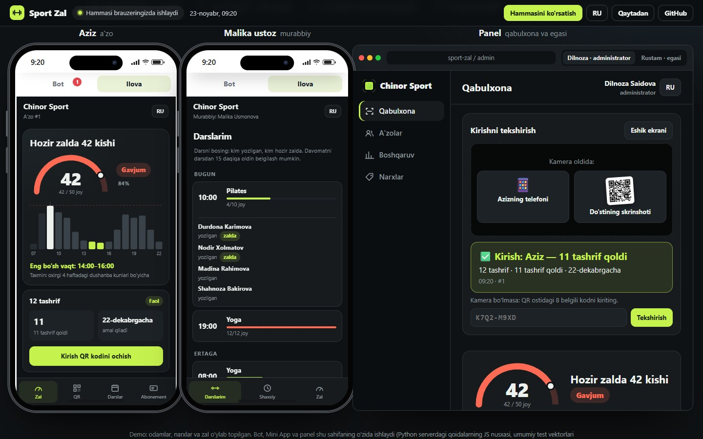

# Sport Zal

[English](README.md) · **O'zbekcha**

[](https://github.com/xoliddev/sport-zal/actions/workflows/ci.yml)
[](https://xoliddev.github.io/sport-zal/)
[](LICENSE)

**Sport zal uchun tizim**: a'zolar uchun Telegram Mini App, qabulxona va zal egasi uchun veb-panel, xabarlar uchun bot.
To'rt xil foydalanuvchi bor: **a'zo**, **murabbiy**, **administrator** (qabulxona) va **egasi**.

**Asosiy narsa — zal hozir qanchalik band.** A'zo ilovani ochishi bilan *"Hozir zalda 41 kishi"* yozuvini, band-bo'shlik
ko'rsatkichini (Bo'sh / O'rtacha / Gavjum) va **bugun soatma-soat taxminni** ko'radi. Taxmin o'tgan 4 haftadagi shu kun
(masalan, dushanbalar) bo'yicha hisoblanadi va eng bo'sh vaqtni ko'rsatadi: *"Eng bo'sh vaqt: 14:00–16:00"*.
Qabulxona aynan shu sonni ko'radi — ilova, panel, eshik ekrani va bot uchun son bitta joyda hisoblanadi — va kimdir
kirishi bilan u darhol o'zgaradi.

**Har 30 soniyada yangilanadigan QR.** A'zo ilovasidagi QR kod har 30 soniyada yangi bo'ladi va bir marta o'qiladi.
Shuning uchun do'stiga yuborilgan skrinshot bir daqiqada ishlamay qoladi. Qabulxona uni kamera bilan o'qiydi (yoki QR
ostidagi 8 belgili kodni yozadi): *"✅ Kirish: Aziz — 11 tashrif qoldi"*, *"⚠️ Abonement tugagan"*, *"⚠️ Ertalabki
abonement: hozir 18:40"*, *"❌ QR eskirgan yoki soxta"*.

**[Jonli demo →](https://xoliddev.github.io/sport-zal/)** Azizning telefoni, Malika ustozning telefoni va admin panel
yonma-yon, 10 qadamli hikoya bilan. Hammasi brauzeringizda ishlaydi.



## Nimalar bor

- **Abonementlar:** "12 tashrif", "1 oy cheksiz", "Ertalabki (07:00–12:00)", "3 oy cheksiz". Narx so'mda, muddat,
  tashriflar soni, kirish vaqti. Qabulxonada sotiladi va uzaytiriladi (naqd yoki karta — to'lov joyida olinadi,
  tizim faqat yozib qo'yadi). Oldindan sotib olingan yangi abonement eskisi tugagan kundan keyin boshlanadi.
- **Muzlatish:** a'zo (yoki qabulxona) abonementni N kunga muzlatadi (oyiga 7 kun), tugash sanasi aniq N kunga
  suriladi. Tugashiga 3 kun qolganda va 1 ta tashrif qolganda bot bir martadan eslatadi (kechasi yozmaydi).
- **Kirish:** QR yoki kod, chiqishda yana skanerlash, 3 soatdan keyin avtomatik chiqarish. Ikki qabulxona bir QR ni
  bir vaqtda skanerlasa ham a'zo faqat bir marta kiritiladi, tashrif bir marta ayriladi.
- **Darslar va murabbiylar:** Yoga, Crossfit, Boks, Pilates, Stretching — haftalik jadval va joylar soni. To'lgan
  darsga navbat bor; kimdir bekor qilsa (darsdan 2 soat oldingacha mumkin), navbatdagi birinchi kishi avtomatik
  yoziladi va botdan xabar oladi. Murabbiy o'z ro'yxatini, kim hozir zaldaligini ko'radi va davomatni belgilaydi;
  shaxsiy mashg'ulot vaqtlarini qo'shadi, a'zolar ularni band qiladi.
- **Admin panel** (kompyuter uchun, telefonda ham ishlaydi): qabulxona (kamera, kod, katta javob, eshik ekrani,
  bugungi kirishlar), a'zolar (qidirish, sotish, uzaytirish, muzlatish), boshqaruv (jonli son va taxmin,
  tugayotganlar va eslatma tugmasi, oylik daromad faqat egasiga, darslar to'lishi), narxlar (faqat egasi o'zgartiradi).
- **Bot:** faqat tugmalar, yagona buyruq `/start`, har ekranda "⬅️ Orqaga". O'zbekcha, bir bosishda ruscha.

Odamlar, narxlar va zal — **o'ylab topilgan**.

## Xavfsizlik

- Mini App har so'rovda Telegram imzosi (`initData`) bilan keladi, imzo va vaqti tekshiriladi.
- Panelga parolsiz kiriladi: botdagi "🔐 Panelga kirish" tugmasi 10 daqiqalik, bir martalik havola beradi (yoki
  Telegram Login Widget). Sessiya HttpOnly, SameSite=Strict cookie'da; har bir o'zgartirish CSRF tokeni bilan.
- Har kim faqat o'zinikini ko'radi: a'zo — o'z abonementini, murabbiy — o'z darslarini; administrator narxni
  o'zgartira olmaydi va daromadni ko'rmaydi.
- QR kod server kaliti bilan imzolanadi, har 30 soniyalik qadam bir marta qabul qilinadi.
- Hamma kiritilgan ma'lumot tekshiriladi, SQL parametrli, chastota cheklangan, CSP qat'iy; konteyner root emas.
  Repoda hech qanday kalit yo'q (`.env` gitignore'da, `.env.example` da faqat namunalar).

## Ishga tushirish

```bash
cp .env.example .env          # BOT_TOKEN (@BotFather), OWNER_IDS ga o'z Telegram id'ingiz
pip install -r requirements.txt
python -m sportzal
```

Mini App va panel uchun ochiq HTTPS manzil kerak (`PUBLIC_URL`, masalan bepul cloudflared tunnel). Docker bilan:

```bash
docker compose up -d --build
```

## Testlar

- **pytest (32):** qoidalar, butun hikoya, rollar, ikki qabulxona bir vaqtda, bot (soxta Telegram bilan), HTTP.
- **node --test (11):** JS nusxasi Python bilan bir xil natija beradi; demo hikoyasi 30 kun ketma-ket va Yangi yilda.
- **Playwright (53 tekshiruv):** demo 1440 px va 375 px da, konsolda bitta ham xato yo'q.

MIT © xoliddev
